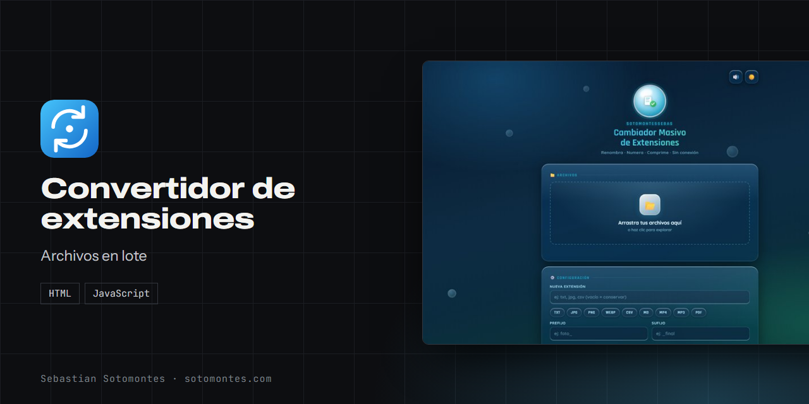
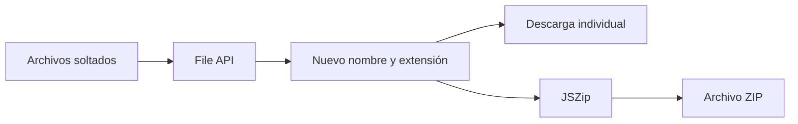

Renombra, numera, cambia la extensión y comprime muchos archivos a la vez, sin subirlos a ningún servidor.

<a href="https://sotomontes.com/#convertidor-de-extensiones"><b>Ver en sotomontes.com</b></a> · <a href="#cómo-se-usa">Cómo se usa</a> · <a href="#cómo-funciona-por-dentro">Cómo funciona</a> · <a href="#novedades">Novedades</a>

| Ficha técnica | |
|---|---|
| **Autor** | Sebastian Sotomontes |
| **Tipo** | Archivos en lote |
| **Plataforma** | Navegador web, sin instalación |
| **Versión** | 1.0 |
| **Estado** | Estable |
| **Stack** | HTML · JavaScript |
| **Código** | Privado. Esta página es solo una presentación. |

---

## Qué es

Herramienta para renombrar muchos archivos a la vez desde el navegador. Cambia extensiones, añade prefijos o sufijos, numera en lote y comprime el resultado.

## Novedades

- Funciona sin conexión y comprime en ZIP.

## Cómo se usa

1. Arrastra tus archivos a la zona indicada o haz clic para explorar.
2. Escribe la nueva extensión o déjala vacía para conservarla.
3. Añade un prefijo o un sufijo si lo necesitas, por ejemplo `foto_`.
4. Activa la numeración para ordenarlos.
5. Descarga los archivos, uno a uno o todos en un ZIP.

## Funciones

- **Arrastrar y soltar** muchos archivos a la vez.
- **Cambiar extensión**, añadir prefijo y sufijo, y numerar en lote.
- **Comprimir** todo en un solo ZIP.
- **Sin conexión**: los archivos no salen de tu equipo.

## Detalles

- Accesos rápidos a TXT, JPG, PNG, WEBP, CSV, MD, MP4, MP3 y PDF.
- Funciona sin conexión.

## Privacidad y seguridad

Ningún archivo sale de tu navegador. No hay analítica ni llamadas externas.

## Cómo funciona por dentro

### Flujo

### Cómo funciona

El navegador puede leer archivos locales con la **File API** y volver a entregarlos sin salir del equipo.
La app toma los archivos que sueltas, les aplica el nuevo nombre y extensión en memoria, y te devuelve cada uno
—o todos juntos en un **ZIP** (con JSZip)— para descargar. No hay subida, no hay servidor y funciona sin conexión.

### Tecnologías

- **HTML + CSS + JavaScript** (sin framework), en un solo archivo.
- **File API / Blob / `URL.createObjectURL`** para leer y entregar archivos en el cliente.
- **JSZip** para empaquetar la descarga.

**Créditos:** usa JSZip.

---

© 2026 Sebastian Sotomontes. Todos los derechos reservados.
